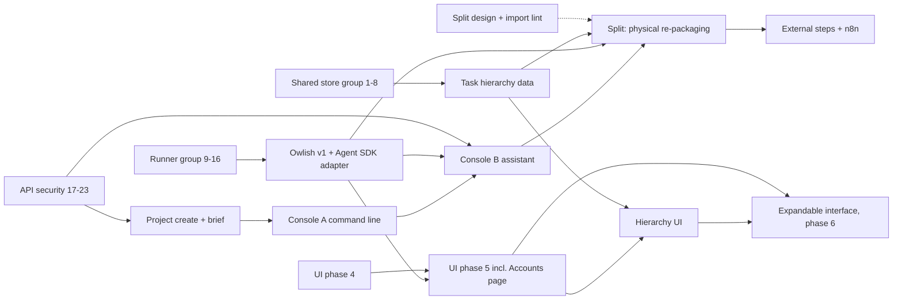

# Boof roadmap: the owner's ideas, reviewed and ordered

Status: proposal for the owner, 2026-10-29. Branch dev/finish-goals. Not committed.
Inputs: `.superpowers/goals-run/owner-ideas.md` (verbatim ideas), `.superpowers/goals-run/review.md` (triage of 66 goals; its section 2 order is already being executed), `goals/*/goal.boof.xml`, the UI redesign spec of 2026-10-27, and better-ccflare 3.5.105 as installed here (its binary is x86-64 and does not run on this arm64 box, so facts come from its README and docs).

## 1. Review of each idea

### 1.1 Split boof into sub-apps (boof-split)

What it asks: cut the monorepo into four sub-apps, "boof itself should be an orchestration between them". Owner's mapping: **Runner** = engine + agent adapters; **Facedisk** = task store, projects, plans/goals, CLI, desktop, web UI; **Heart** = budget/usage, settings, auth, REST, MCP, web server; **Owlish** = accounts and model routing, "handles observers, pause the agents to spend wisely". Ops (service install, remote) unassigned. Every job must work over MCP, REST, CLI, web and desktop.

What exists: seven packages already close to this: `shared` (stores, settings, auth store, budget ledger), `runner`, `api` (operations registry + services), `mcp`, `web` (server + UI), `desktop`, `bin` (CLI, the composition root that wires everything). The registry already guarantees REST/MCP parity; the CLI is hand-written on top.

Problems with the mapping as given:

- The task store sits in Facedisk but the REST API that serves it sits in Heart, and the runner reads it too; both would depend on Facedisk, so the store is the real core. Recommend: stores, settings and auth are **Heart**; Facedisk is the human surfaces (UI, desktop, CLI). Ops (the `service` command, deploy files) goes with the web server in Heart.
- "Separate completely" can mean enforced package boundaries in one repo, separate processes, or separate repos. Processes and repos cost versioning, inter-process auth and three release pipelines and give a single-user local tool nothing. Only Owlish is naturally a process (a proxy).

Conflict: task-hierarchy changes the store, Owlish the adapters, the console the shell, and 44 fixes are landing on the same files. Moving files now guarantees merge pain.

Recommendation: **reshape**. Design now (names, boundaries, interfaces), enforce boundaries with an import lint early (no moves), re-package once, late. "Orchestration" = `bin` stays the composition root that starts Heart, Runner and optionally Owlish.

### 1.2 n8n pipelines

What it asks: n8n can run the process, user reviews and edits pipelines in boof, each edit spawns a check task, boof works with or without n8n, low priority.

What exists: signed webhooks for every event, task creation over REST/MCP, idempotency keys. What does not: running one pipeline step from outside. The pipeline (fix rounds, verdicts, worktree, steering) is one loop in `pipeline.ts`; "run one step" means making worktree, plan, reports and round state addressable per call, a large refactor of the runner's core for a low-priority feature. n8n has no "workflow edited" webhook (poll `GET /workflows`, compare `updatedAt`) and its editor cannot be embedded, only linked.

Recommendation: **defer and reshape**. Instead of "run one step", add **external steps**: a step kind that calls a webhook and waits for a callback (`POST …/tasks/:id/steps/:step/complete`). n8n, or anything, can insert work before or after the built-in roles; boof stays complete without it. "Review pipelines in boof" = a list of n8n workflows via its REST API with links; "check after edit" = a poller that queues a task when `updatedAt` changes. Last on the roadmap.

### 1.3 Task hierarchy

What it asks: "all task should have prio. task shoul have parents. project -> epic (optional) -> task -> subtask (optional) add these only to todos".

What exists: `priority` (integer) on every task; the scheduler orders by it. Plan → goals → tasks is already a grouping (each goal spawns one task with `planRef`), so "epic" overlaps with "goal" almost completely. The shared-store fixes are in flight on `store.ts`.

"add these only to todos" most likely means "put this on the backlog, do not build it now"; the other reading is "only tasks that have not started get a parent". I take the first; it changes the order, not the design.

Recommendation: **reshape to the smallest model**: `parentId` on a task (a subtask's parent is a task in the same project) and `epicId` pointing at a small epic record (`projects/<id>/epics.json`: id, title, priority, order). Progress of an epic or a parent is derived from children, never stored. The scheduler stays priority-first; a parent's priority is only a tiebreak. Files without a parent stay top level (no migration). A plan goal may name an epic so sync drops its tasks there. Two steps: data + API/MCP/CLI after the shared-store group, UI grouping later.

### 1.4 Minimum expandable interface

What it asks: "a simple panel should be presented to the users but they should be able to expand it to find more complex panel. the complexity should get handled in the backend."

What exists: the redesign's "Now first" idea already has this shape (Now lane and needs-you on top, dense lists below), `runner.overview` computes the summary server-side, and phases 1-3 are built.

Conflict: the redesign's anti-goal "hiding density behind whitespace; the owner wants to see twenty tasks and fifty goals without paging", and §10 reserves Overview and task-detail changes for the owner. If "simple" means hiding the lists, the two documents contradict.

Recommendation: **merge into the redesign as a per-screen "focus" toggle**: simple = Now lane, needs-you, console and one primary list; expanded = the screen as today; remembered per screen in local storage; nothing actionable (running work, questions, errors) is ever hidden. Build it in phase 6, once phases 4 and 5 exist to be collapsed. The owner defines "simple" for Overview and task detail; the builder decides the rest.

### 1.5 Chat console and project creation

What it asks: (a) "alwayse, show a chatbox in the bottom of the page like terminal in boof. users should be able to communicate with the page with that input"; (b) create a project with a new, existing or automatic path; (c) a new project "should alwayse have a new input to define and explain the project".

What exists: a command palette (Ctrl/⌘K, `shell/CommandPalette.tsx`) that jumps and runs queue/stop/new task; the steer box; `projects.create` (needs an existing git work tree; API clients limited to `allowedProjectRoots`); `AddProjectModal`; CLI `project add`; boof's own MCP server with 34 tools.

Conflicts and risks: two command inputs on every page (palette and console) confuse; a model-backed chat costs money per message and must not run destructive operations unconfirmed. The backlog makes the console depend on owlish-accounts, which blocks a cheap feature behind an expensive one.

Recommendation: **split into three and reorder**.

1. **Project creation with path and brief**: `path` modes new, existing, automatic (`settings.projectsRoot`, default `~/boof-projects/<id>`, mkdir + `git init`, refuse a non-empty directory without confirmation) and a `brief` in `project.json` that the planner prompt includes as `## Project`. Desktop gets a native folder picker. Ships before the console.
2. **Console A, deterministic**: a persistent input at the bottom of the shell sharing one command registry with the palette (the palette becomes its pop-up view). Slash commands (`/task`, `/queue`, `/stop`, `/open`, `/project new`), history, output lines, confirms on destructive commands. No model, no cost, works offline; collapses to a bar on phones.
3. **Console B, assistant**: free text goes to a "concierge" agent, which is boof's own Claude adapter with boof's **own MCP server** attached under a scoped API client (read + tasks:write, no control scopes). It creates tasks, answers questions and explains the page; destructive actions still pass the UI's confirm. Depends on the API security group and the harness choice, not on the account pool.

### 1.6 Accounts: better-ccflare in boof (Owlish)

What it asks: "users can add different types of account like claude, chatgpt and use them in boof. boof under the hood might use claude code or other harnesses. but choose a harness that boof can control itself."

What better-ccflare is (3.5.105; [repo](https://github.com/tombii/better-ccflare), [load-balancing.md](https://github.com/open-horizon-labs/better-ccflare/blob/main/docs/load-balancing.md), [PR #466](https://github.com/tombii/better-ccflare/pull/466)): an HTTP proxy on port 8080 speaking the Anthropic Messages API (and `/v1/responses` for Codex clients) that routes each request to one account of a pool: Claude OAuth (5-hour windows), Claude console keys, Codex OAuth, Bedrock, Vertex, OpenRouter, Ollama, OpenAI-compatible and more. Balancing is **session-only** (sticky per account per window; other strategies "risk bans"), with priorities, auto-fallback when a window resets, manual and threshold pause (percentage of the 5-hour or weekly window), fallback chains ("combos") per model family, per-request analytics, a dashboard, a REST API (`/api/accounts`, pause/resume, `/health` healthy/degraded/unhealthy, 503 when the pool is exhausted) and client API keys. A client needs only `ANTHROPIC_BASE_URL` (or `OPENAI_BASE_URL` for Codex).

What exists in boof: adapters spawn `claude`, `codex`, `opencode` with the inherited environment (`exec.ts` takes an `env`; nothing sets a base URL yet); `now` steering kills the process and resumes the session; budget ledgers per day, project and tool with `onExceed: pause`; 503/529 already count as transient; usage parsing per tool (codex cost unknown, backlog `usage-ledger-accuracy`).

Risks of rebuilding the pool in boof: OAuth and token refresh for many providers, provider terms, credentials at rest (boof has no secrets store; `webhook-secrets-at-rest` is still open), and duplicating a project that ships weekly: an XL effort that lags the original.

Harness boof can control: all three have SDKs. The [Claude Agent SDK](https://code.claude.com/docs/en/agent-sdk/typescript) gives `query()` with streaming input, `interrupt()`, `streamInput()`, `setModel()`, session resume, hooks and permission callbacks, and honours `ANTHROPIC_BASE_URL`; the [Codex SDK](https://developers.openai.com/codex/sdk) gives `startThread().run()/runStreamed()` and `resumeThread()`; [OpenCode](https://opencode.ai/docs/sdk/) runs as a server with sessions and `/session/:id/abort`. Boof's `Tool` interface already abstracts these: the harness is an adapter choice, not an architecture choice.

Recommendation: **reshape into integration plus policy**.

- Owlish v1 = better-ccflare as the pool, boof as client and controller: `settings.owlish { url, apiKey }`; adapters set the base URLs on child processes; an **Accounts** page in Settings that proxies ccflare's REST API through boof (list, priority, pause/resume, usage, link to its dashboard for OAuth sign-in); a health gate in the engine (pool degraded or exhausted = start nothing new, say so in the Now lane and `runner.status`). That is the "pause the agents to spend wisely" part, and it fits the split: Owlish is a process boof orchestrates.
- Harness: add an **Agent SDK adapter** (`claude-agent`) beside `claude-code`: real `interrupt()` + `streamInput()` instead of kill-and-resume, permission hooks, per-call model switching; default role tool when installed. Keep the CLI adapters; Codex SDK later if wanted.
- Owlish v2 (optional, later): vendor or fork ccflare into `@boof/owlish` once v1 shows which features matter.

### 1.7 Finishing everything, and this request

Already in motion: 44 ready goals in the review's order, Sonnet implements, Fable plans, Opus reviews. This document only places the six product ideas around that stream.

## 2. Dependencies

Bug groups not shown (web server 24-31, CLI/desktop 32-39) have no idea-level dependency; they are interleaved for file locality.

## 3. Roadmap

Sizes: S < 100 lines, M 100-400, L 400-1500, XL more. "Backlog n" is the review's section 2 numbering. Every step leaves the app usable; design steps run beside the fix groups.

0. **Decide batch 1** (owner, now, no code): D1-D4 below. Done: answers written into the four goal files.
1. **Shared store group** (backlog 1-8). S-M. Closes the eight store goals. Done: vitest green, no task ever in two status directories.
2. **Design documents** (beside 1, Fable agent): split design (names, boundaries, interfaces, ops, migration order), Owlish design (ccflare integration, Accounts page, health gate, Agent SDK adapter), hierarchy design (schema, API shapes, prompt impact). M. Needs D1-D3. Done: owner approves each; an **import-boundary lint** lands with the split design (CI fails on cross-package reach-ins) without moving files.
3. **Runner group** (backlog 9-16). S-M each. Closes the eight runner goals. Done: vitest green.
4. **Task hierarchy, data and surfaces** (after 1, 3). M-L. `parentId`, `epicId`, epics store, `tasks.list?parent=`, `epics.*` operations in the registry (REST and MCP for free), CLI `task move` and `epic add`, derived progress, plan goals may name an epic; task detail shows parent and children. Closes task-hierarchy (data half). Needs D3. Done: old task files load unchanged; store and API tests for create, move, list by parent.
5. **API security group** (backlog 17-23). S-M. Done: security tests green.
6. **Project creation with path and brief** (after 5). M. `projects.create` gains `path: {mode: new|existing|auto}` and `brief`; `settings.projectsRoot`; mkdir + git init; non-empty directories need `confirm`; planner prompt gains `## Project`; UI modal rebuilt on Dialog (closes the Projects part of ui-a11y); CLI flags; desktop folder picker. Closes project-create-with-path. Needs D6. Done: API and CLI tests for the three modes; a task in a new project carries the brief in its planner prompt.
7. **Web server group** (backlog 24-31). S-M. Done: hardening tests green.
8. **Owlish v1** (after 3 and the design). 8a **ccflare integration** (M): `settings.owlish`, base URLs on child processes, `accounts.*` proxy operations (REST, MCP, CLI), health gate in `selectWithBudget`, `runner.status.pool`. 8b **Agent SDK adapter** (L): `claude-agent` tool with streaming input, `interrupt()` for `now` steering, model switching, usage from SDK messages. Closes owlish-accounts. Needs D2. Done: with ccflare down the engine pauses with a visible reason; a steered step continues without a process kill; accounts list in CLI and MCP.
9. **CLI, desktop, install group** (backlog 32-39). S-M. Done: `--version`, graceful quit, pid files, service options kept, npm install works, docs pass.
10. **UI phases 4 and 5** (backlog 40-47). L + L. Phase 5 adds the **Accounts** page (from 8a) and project creation under Project settings (from 6). Closes the merged UI goals. Done: one PR per phase, screenshots, app usable throughout.
11. **Console A and hierarchy UI** (after 6, 10). M + M. Bottom console sharing the palette's registry; Tasks grouped by epic, subtasks indented, epic progress in the header. Closes chat-console (command half), task-hierarchy (UI half). Needs D4. Done: every palette action runs from the console; parser tests; 420 px check.
12. **Console B, the assistant** (after 8b, 11). M-L. Concierge through the Agent SDK adapter with boof's MCP server under a scoped client; page context (project, task, screen) passed in; writes pass the UI confirm; spend recorded under `tool:concierge`. Closes chat-console. Needs D4. Done: "create a task to fix X" yields a draft task; "delete" asks first; without a model the console still works as A.
13. **UI phase 6 with the expandable interface** (backlog 48 + ui-minimum-expandable-interface). L. Per-screen focus toggle, remembered; dark pass; a11y; `styles.css` removed. Needs D5. Done: screenshots simple and expanded, light and dark, 420 px and desktop.
14. **Release 0.3.0** (backlog 49-50, release goals). S. verify-steering-codex, typescript-7 if published, CHANGELOG and bump by an agent, tag by the owner, publish runbook. Needs D8. Done: tag pushed, release workflow green.
15. **Split: physical re-packaging** (after 4, 8, 12). L-XL. `@boof/runner` (engine, adapters), `@boof/heart` (stores, settings, auth, budget, registry, REST, MCP, server), `@boof/facedisk` (UI, desktop, CLI commands), `@boof/owlish` (ccflare client, pool policy, accounts operations); `bin` orchestrates. Parity test: every operation over REST, MCP and CLI. Closes boof-split. Needs D1 confirmed against the design. Done: the lint enforces four boundaries; all tests green; install unchanged for users.
16. **External steps and n8n** (last). L. Step kind `external` with webhook + callback operation; n8n workflow list via its API; edit poller that queues a check task; docs with and without n8n. Closes n8n-pipelines. Needs D7. Done: a mock external step completes a task end to end; the app runs with n8n absent.

## 4. Decisions for the owner

Most important first; each with the recommended answer.

- **D1. Split: what does "separate completely" mean, and where does the store go?** Recommend: enforced package boundaries in one repo (import lint, four packages), not processes or repos; stores, settings and auth are Heart, Facedisk is UI/desktop/CLI, ops goes to Heart; files move once, at step 15. Why: a single-user local tool gains nothing from process boundaries except Owlish, which is a proxy anyway; moving files during 44 fixes creates conflicts.
- **D2. Owlish: integrate better-ccflare or rebuild it? Which harness?** Recommend: integrate (ccflare as the pool, boof as controller and policy), revisit vendoring after v1; add a Claude Agent SDK adapter as the controllable default, keep the CLI adapters. Why: ccflare already does OAuth, windows, fallback and analytics and ships weekly; the Agent SDK's interrupt and streaming input fix the kill-and-resume steer.
- **D3. Hierarchy model.** Recommend: `parentId` for subtasks, `epicId` to a small epic record per project, priority per task (epic priority a tiebreak), progress derived, scheduler unchanged. Confirm "add these only to todos" meant "put it on the backlog". Why: smallest store change, no migration, no second scheduler.
- **D4. Console: command line first, assistant later, one registry shared with the palette; the assistant uses boof's own MCP server through a scoped client.** Recommend yes. Why: ships early, costs nothing per keystroke, reuses what exists.
- **D5. Expandable interface: what is "simple" on Overview and task detail?** Recommend: Overview = Now lane + needs-you + console; task detail = step strip + live log + steer, prompt and settings collapsed; one remembered toggle per screen. Why: honours "simple first" and the redesign's density rule.
- **D6. Project creation: automatic root and brief.** Recommend `~/boof-projects/<id>` (a setting), brief required for new paths, optional for existing, injected into the planner prompt. Why: predictable paths; the brief is the only context a fresh repo has.
- **D7. n8n: external steps via webhook callback instead of "run one internal step", kept last.** Why: pipeline state is not safely addressable per step; external steps give n8n the same power without a runner rewrite.
- **D8. Still open from the triage:** step-closing-entry (recommend yes), 0.3.0 without the desktop end-to-end check and who tags (recommend ship, owner tags), publish-runbook (recommend at 0.3.0).

## 5. Owner's answers (2026-10-29)

- **boof-split**: D1 (owner, 2026-10-29): same repo, different boundaries — enforced package boundaries (import lint, four packages: Runner, Heart, Facedisk, Owlish), not processes or repos. Heart holds the stores, settings and auth; Facedisk is the UI, desktop app and CLI; ops goes to Heart. Files move once, late (roadmap step 15), after the backlog fixes.
- **owlish-accounts**: D2 (owner, 2026-10-29): integrate better-ccflare rather than rebuild it — boof controls it and applies the spend rules. Check the legal side first (better-ccflare's licence and what it allows when bundling, integrating or calling it) and credit it by name (better-ccflare) in the docs and the UI where it is used. Harness: choose the best solution (roadmap recommends adding a Claude Agent SDK adapter as the controllable default and keeping the CLI adapters); record the reasoning in the design.
- **task-hierarchy**: D3 (owner, 2026-10-29): approved — subtasks carry parentId; epics are a small record per project; priority stays on each task (epic priority a tiebreak at most); progress is derived; the scheduler is unchanged. 'Add these only to todos' meant: put it on the backlog.
- **chat-console**: D4 (owner, 2026-10-29): 'one line always on bottom like a terminal. always interactive. receives the info and add or modify the plans.' A single always-visible, always-interactive line at the bottom of every page; it takes what the user types (information, instructions) and adds to or modifies the plans (and tasks), as well as running page commands. Deterministic commands come first and share the command palette's registry; free text that must be interpreted goes through the assistant (boof's own MCP server under a scoped client). It does not wait for owlish-accounts.
- **ui-minimum-expandable-interface**: D5 (owner, 2026-10-29): go — simple Overview = Now lane + needs-you + the console; simple task detail = step strip + live log + steering, with the form collapsed; one remembered simple/expanded toggle per screen; never hide actionable items. Built in UI phase 6.
- **project-create-with-path**: D6 (owner, 2026-10-29): approved — automatic paths at ~/boof-projects/<id> (a setting); a brief is required for new paths and optional for existing ones; the brief is passed to the planner.
- **n8n-pipelines**: D7 (owner, 2026-10-29): approved — n8n runs external pipeline steps called by webhook with a callback, rather than a 'run one internal step' API; built last.
- **step-closing-entry**: D8 (owner, 2026-10-29): approved — the pipeline appends a closing steps[] entry (Finished / Failed / Stopped with its time) when a run ends; the UI uses it for the last step's duration. No longer waiting on the owner.
- **release-0-3-0**: D8 (owner, 2026-10-29): ship 0.3.0 without the desktop end-to-end check; an agent prepares the version bump and changelog; the owner pushes the tag.
- **publish-runbook**: D8 (owner, 2026-10-29): publish the runbook with 0.3.0.
