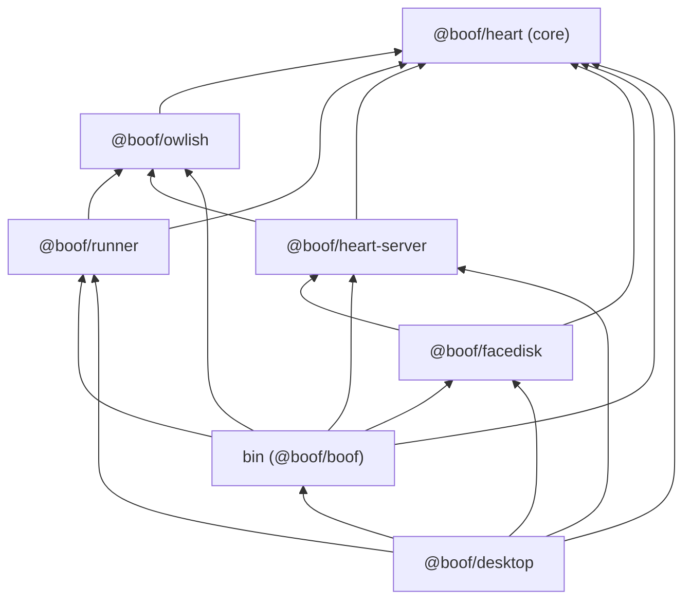

# Boof split design: four parts, one repo

Date: 2026-10-30. Status: draft for the owner (roadmap step 2). Branch dev/finish-goals. Not committed. Implements goal `goals/boof-split` under decision D1 (owner, 2026-10-29): same repo, enforced package boundaries, four parts (Runner, Heart, Facedisk, Owlish), files move once at roadmap step 15.

Inputs: the roadmap (§1.1, §3 steps 2 and 15, §4 D1, §5), `goals/boof-split/goal.boof.xml`, the owner's verbatim grouping in `.superpowers/goals-run/owner-ideas.md`, the Owlish design of 2026-10-30, and the code as it stands (import graph measured on 2026-10-30, see §2).

Calls that are mine, not the owner's, are marked **(my call)**. Owner questions are collected in §11, most important first.

## 1. Summary

- Four sub-apps, six workspace packages plus two thin entry points. **Heart has two floors**, so it is two packages: `@boof/heart` (the core: schema, stores, settings, auth, budget, events, plan logic, git queries) and `@boof/heart-server` (operations registry, services, REST, MCP, web server, webhooks). Runner and Owlish sit between those floors, which is why one package cannot hold both.
- Dependency direction, strictly one way: `heart ← owlish ← runner`, `heart-server → heart, owlish` (never Runner: the tool registry is injected through a `ToolCatalog` interface), `facedisk → heart-server, heart` (never Runner, never Owlish), and `bin` plus the desktop main process compose everything.
- The owner's grouping put the task store, projects and plans in Facedisk; the measured graph says the stores are the floor every part stands on. I follow D1 (stores in Heart) and explain the conflict in §4; it is owner question 1.
- "Every job via MCP, REST, CLI, web and desktop" becomes a rule plus a test: a job is an operation in the registry (`defineOp`), REST and MCP are already generated from it, the CLI gains a generated `boof-runner <area> <verb>` command set, the UI keeps a coverage manifest, and one parity test in `bin` walks the registry and checks all four surfaces. The CLI today bypasses the registry entirely (it reads stores directly), so this is the biggest parity gap.
- The import-boundary lint lands now, as a vitest test with a folder-to-part map and a short allow-list of the seven known violations (all `heart-server → runner` and `facedisk-cli → runner`), without moving a file. No eslint or dependency-cruiser: the repo has neither, and one rule over a folder map is a hundred lines.
- The physical move at step 15 is eight mechanical pull requests (M1 to M8), each green, `git mv` to keep history, install unchanged for users. M1 (re-home plan sync, git queries, diff and usage out of Runner into Heart core; add `ToolCatalog`) is the only step that changes code rather than paths, and it is what makes `heart-server` independent of Runner.

## 2. What exists: the measured import graph

Non-test imports between workspace packages, counted on dev/finish-goals (2026-10-30). Test files are discussed separately.

| From      | Imports                                        | Where the non-obvious edges come from                                                                                                                                                                                                                                                                                                                                                                                                                                    |
| --------- | ---------------------------------------------- | ------------------------------------------------------------------------------------------------------------------------------------------------------------------------------------------------------------------------------------------------------------------------------------------------------------------------------------------------------------------------------------------------------------------------------------------------------------------------ |
| `shared`  | nothing of ours                                | The floor: schema, ids, paths, atomic writes, TaskStore, ProjectStore, PlanStore, SettingsStore, AuthStore, CommandStore, AttachmentStore, WebhookSecretStore, budget ledger, events, migration, plan validate/diff/ops/xml, boof-goal parsing, scopes, version                                                                                                                                                                                                          |
| `runner`  | `shared`                                       | Engine and pipeline read and write every store; `plan-sync.ts` reads `AuthStore` to decide whether an external client is trusted (`taskStatusForPlan`)                                                                                                                                                                                                                                                                                                                   |
| `api`     | `shared`, `runner`                             | `services/service.ts`: git queries (`isGitRepo`, `repoCommonDir`, `currentBranch`, `pruneStaleWorktrees`), `taskDiff`, `ToolRegistry` (health, models), `UsageStore`, `sumUsage`; `services/plan-service.ts`: `syncPlan`, `importFromRepo`, `mergeImportedGoals`, `archiveRemovedGoalTasks`, `taskStatusForPlan`; `ops/projects.ts`: `currentBranch`; `services/model-details.ts`: the `CachedHealth` type. `TaskService`'s constructor defaults to `new ToolRegistry()` |
| `mcp`     | `api`, `shared` (dev: `runner` for `MockTool`) | Tools, resources and prompts are generated from the registry; `stdio.ts` builds `new TaskService(root)` with the default registry                                                                                                                                                                                                                                                                                                                                        |
| `web/src` | `api`, `mcp`, `runner`, `shared`               | `server.ts` constructs the default `ToolRegistry`; `mcp-route.ts` mounts `/mcp`; `rest.ts` mounts the registry; `webhooks.ts`, `events.ts`, `watch.ts` read the data root                                                                                                                                                                                                                                                                                                |
| `web/ui`  | `shared` (types only, 20 `import type`)        | The React UI talks to the server over HTTP only (`ui/src/api.ts`); it duplicates a few response shapes in `ui/src/api-types.ts`                                                                                                                                                                                                                                                                                                                                          |
| `desktop` | `runner`, `web`, `shared`                      | `main.ts` is a composition root: migrates the data root, creates the desktop API client, starts the server and the engine, opens the window                                                                                                                                                                                                                                                                                                                              |
| `bin`     | `runner`, `web`, `mcp`, `shared`               | Not `api`. `serve` composes server + engine; `headless.ts` (run, scan) drives the engine in-process; `project-cli`, `plan-cli`, `auth-cli`, `remote-cli`, `service-cli` go straight to the stores and to runner's plan sync and git helpers                                                                                                                                                                                                                              |

Findings that shape the design:

1. **The CLI is not a registry client.** None of the 66 operations is reachable from the CLI by name; the hand-written commands cover projects, plans, auth, remote, service, mcp, run and scan, and nothing for tasks, settings, commands, webhooks or usage. REST serves all 66 (`web/src/contract.test.ts` proves it); MCP serves 34 (`api/src/contract.test.ts` requires admin, auth and file-transfer operations to be hidden).
2. **The UI is already decoupled**: HTTP plus type-only imports. It can move anywhere.
3. **`api` reaches into `runner` for things that are not "engine and adapters"**: plan sync and import, git queries, task diff, usage math. These are store-and-repository logic that the engine happens to host. The one true engine dependency is the tool registry (health and models), which `TaskService` already takes by injection but also constructs by default.
4. **Runner reaches into auth** (`AuthStore` in `plan-sync.ts`). Under the owner's grouping auth is Heart, so Runner depends on Heart. That is fine as long as Heart's upper floor does not depend on Runner, which is what finding 3 is about.
5. **Composition is duplicated**: `bin/src/boof-runner.ts` `serve()` and `packages/desktop/src/main.ts` `boot()` do the same five things (migrate root, start server, start engine, guard against a second runner, graceful shutdown).
6. **Test files already cross boundaries** (`mcp` lists `runner` as a devDependency for `MockTool`; `web/src/e2e.test.ts` runs the engine against the REST app). TypeScript project references exclude tests, so this creates no build cycle.
7. **The repo has vitest and prettier, no eslint, no dependency-cruiser.** CI runs `typecheck`, `test`, `lint` (prettier), `build`, plus an npm-only install job that asserts workspace symlinks under `node_modules/@boof-runner/*` and runs the built CLI.
8. **Churn is real**: since 1 October, `pipeline.ts` has 26 commits, `app.ts` 20, `engine.ts` 17, `service.ts` 17, `store.ts` 16. Moving these files before the fix groups land would conflict with every open plan.

## 3. The four parts and their packages

Package names use the `@boof/` scope (roadmap step 15; owner question 8 confirms the rename). The published package stays `boof-runner` with the `boof-runner` executable.

| Sub-app (owner's name)  | Package(s)                                     | Holds                                                                                                                                                                                                                                                                                                                                                                                                                                                                                                                                                                                                                                                                                                                                                                                                   |
| ----------------------- | ---------------------------------------------- | ------------------------------------------------------------------------------------------------------------------------------------------------------------------------------------------------------------------------------------------------------------------------------------------------------------------------------------------------------------------------------------------------------------------------------------------------------------------------------------------------------------------------------------------------------------------------------------------------------------------------------------------------------------------------------------------------------------------------------------------------------------------------------------------------------- |
| **Boof Heart** (core)   | `@boof/heart` (`packages/heart`)               | Today's `packages/shared/src/*` entire, plus from `runner`: `plan-sync.ts`, `plan-import.ts`, `plan-base.ts`, `boof-scan.ts`, `task-diff.ts`, `untracked-diff.ts`, `usage-store.ts`, `tools/usage.ts` (as `usage-math.ts`), `exec.ts` (a process utility, as `process.ts`), and the query half of `worktree.ts` as `git.ts` (`isGitRepo`, `repoCommonDir`, `currentBranch`, `branchHead`, `pruneStaleWorktrees`, `registeredWorktreeBranch`, `leftoversBranch` (a pure name helper that `task-diff.ts` needs), the private `git()` wrapper, `NotAGitRepoError`, `UnknownBaseRefError`). New: `tool-catalog.ts` (interface plus the `HealthResult` and `HealthStatus` types that today live in `runner/src/tools/types.ts`, §5.2). From `bin`: `scaffold.ts`. Future: the epics store (hierarchy design) |
| **Boof Heart** (server) | `@boof/heart-server` (`packages/heart-server`) | `src/api/` ← `packages/api/src/*` (defineOp, registry, ops, services, errors, openapi, idempotency, net-guard, validation, schemas, warnings, audit); `src/mcp/` ← `packages/mcp/src/*`; `src/server/` ← `packages/web/src/*` (app, rest, server, middleware, events feed, webhooks dispatcher, watcher, mcp-route, security-config, `generated/harness.ts`). Future: `accounts.*` ops (Owlish design), `epics.*` ops (hierarchy design), external steps (n8n)                                                                                                                                                                                                                                                                                                                                          |
| **Boof Runner**         | `@boof/runner` (`packages/runner`)             | `engine.ts`, `pipeline.ts`, `budget.ts` (the budget-exceeded announcer), `pid-file.ts`, the lifecycle half of `worktree.ts` (`createWorktree`, `ensureWorktree`, `finalizeWorktree`, `discardWorktree`, `commitLeftovers`, `excludeRootFromGit`, `diffAgainstBase`; it imports the queries from Heart's `git.ts`), `tools/*` (types, registry, claude-code, codex, opencode, mock, errors, jsonl, questions), from `bin`: `runner-guard.ts`. Future: `claude-agent` adapter, the pool gate calls                                                                                                                                                                                                                                                                                                        |
| **Boof Owlish**         | `@boof/owlish` (`packages/owlish`)             | The better-ccflare client (`OwlishClient`, `PoolStatus`), its secret store, `routingEnv(toolId, settings)` (base URLs and keys for the adapters), the pool observer (health poll, `runner.pool_exhausted` events, "next available at"), the spend rule (`reserveWindowPercent`), the credit text. Built at step 8 under `packages/shared/src/owlish*.ts` (Owlish design §3) and moved at M4                                                                                                                                                                                                                                                                                                                                                                                                             |
| **Facedisk**            | `@boof/facedisk` (`packages/facedisk`)         | `ui/` ← `packages/web/ui` (React, Vite, Tailwind; the desktop bridge types stay in `ui/src/desktop.ts`); `cli/` ← `bin/src/{auth,plan,project,remote,service,mcp}-cli.ts` and their tests, plus the new generated command set `cli/ops.ts` (§6.3) and the UI coverage manifest `ui/src/op-coverage.ts` (§6.4)                                                                                                                                                                                                                                                                                                                                                                                                                                                                                           |
| **boof** (orchestrator) | `bin/` as `@boof/boof`                         | `boof-runner.ts` (argument parsing, dispatch, help, `serve`), `headless.ts` (run, scan: drive the engine in-process), new `boot.ts` (§5.6), the parity test and the boundary test                                                                                                                                                                                                                                                                                                                                                                                                                                                                                                                                                                                                                       |
| boof desktop            | `packages/desktop` as `@boof/desktop`          | Electron main and preload, `lifecycle.ts`, `stage-app.mjs`; uses `boot()` from `bin` and serves Facedisk's built UI. A second composition root, not a Facedisk module (§4, owner question 5)                                                                                                                                                                                                                                                                                                                                                                                                                                                                                                                                                                                                            |

**(my call)** Heart is two packages, not one with two entry points. The reason is mechanical: `tsc -b` project references, `package.json` dependencies and the lint all work per package, and a package cannot both be imported by Runner (stores) and import Owlish and be above Runner (services) without a folder-level rule that outlives the move. Two packages make the boundary the same kind as every other boundary. The owner's word "Heart" still names both floors; docs say "Heart (core)" and "Heart (server)".

**(my call)** `exec.ts` moves to Heart core. It spawns a process with a timeout, an environment, a stop signal and output capture; nothing in it knows about agents. Git queries, plan sync (`git` calls through it) and the adapters all need it, and the adapters are the ones that may not be imported by the others. A builder who prefers to keep `exec.ts` in Runner must then give `git.ts` its own small `execFile` wrapper; either is acceptable, the first is less code.

What does **not** move: `deploy/` (runbook, nginx examples), `scripts/` (install script, harness-guide generator, release-version), `docs/`, `goals/`, root config. `scripts/gen-harness-reference.ts` imports `packages/api/src` and `packages/shared/src` by path and is updated in M3.

## 4. Reconciling the owner's grouping with the graph

The owner's first grouping (verbatim, 2026-10-29) put rows 3, 4 and 5 (task store, projects, plans and goals) in Facedisk together with 12, 13 and 14 (web UI, desktop app, CLI). Later the same day, D1 was answered "Heart holds the stores, settings and auth; Facedisk is the UI, desktop app and CLI". This design follows D1 and here is why the first grouping cannot be built:

- The engine reads and writes the task, project and plan stores on every tick; `Pipeline` writes task files, reports and logs. So Runner would depend on Facedisk.
- Every operation handler reads the same stores. So Heart (server) would depend on Facedisk.
- The desktop app starts the engine and the server, and the CLI's `run` and `scan` drive the engine. So Facedisk would depend on Runner and on Heart.

That is a three-way cycle: Facedisk would be both the floor and the roof. The only way to keep "task store in Facedisk" is to split Facedisk itself into a data package and a surfaces package, at which point the data package is Heart core under another name.

Where each store lives, and why:

| Store or module                                              | Lives in       | Why                                                                                                                                |
| ------------------------------------------------------------ | -------------- | ---------------------------------------------------------------------------------------------------------------------------------- |
| TaskStore, task files, lifecycle, status directories         | Heart (core)   | Read by the engine, the ops, the CLI, the MCP resources; written by the engine and the ops                                         |
| ProjectStore, project files                                  | Heart (core)   | Same readers; its git checks come from `git.ts` in the same package                                                                |
| PlanStore, plan validate/diff/ops/xml, plan sync and import  | Heart (core)   | Sync is called by the engine (auto-sync on tick), by `plans.sync`, by the CLI and by headless; it is store logic, not engine logic |
| SettingsStore, effective settings, role resolution           | Heart (core)   | The owner's own placement (row 7)                                                                                                  |
| AuthStore, scopes, principal                                 | Heart (core)   | The owner's own placement (row 8); the engine needs the trust of a plan's client                                                   |
| Budget ledger and evaluation; usage aggregate                | Heart (core)   | Row 6; written by the engine as steps finish, read by the ops and the UI                                                           |
| Events log, webhook secrets, migration, paths, atomic writes | Heart (core)   | The data-root layout belongs to one owner                                                                                          |
| Epics store (hierarchy design)                               | Heart (core)   | Same as tasks                                                                                                                      |
| Owlish secret store                                          | Owlish         | Owlish's own data under `<data>/owlish/`; uses Heart's atomic-write and paths helpers                                              |
| Idempotency store, audit log, rate-limit state               | Heart (server) | Server-side only; nothing below the server reads them                                                                              |
| UI local storage (theme, filters, focus toggle)              | Facedisk (ui)  | Per-browser conveniences, not data                                                                                                 |

Rule that follows: **the data root's layout is Heart core's.** Other parts touch it only through Heart's stores and `paths.ts` helpers. Runner writes logs, reports and signal files under task directories through those helpers; that is allowed and already so.

Ops (service install, remote access, deploy files), left open by the owner and placed "in Heart" by D1: the server-side pieces (bind check, TLS, host and origin guards, `/healthz`, audit retention) are Heart (server); the `service` and `remote` commands are CLI commands and move with the other commands to Facedisk's `cli/`; `deploy/` stays a top-level folder of runbooks. Owner question 6 confirms.

## 5. Dependency direction and the interfaces between the parts

### 5.1 Allowed edges (production code)



| From           | May import                                    | Must not import                      | Notes                                                                                                |
| -------------- | --------------------------------------------- | ------------------------------------ | ---------------------------------------------------------------------------------------------------- |
| `heart`        | nothing of ours                               | everything else                      | Third-party: zod, gray-matter, fast-xml-parser, node                                                 |
| `owlish`       | `heart`                                       | `runner`, `heart-server`, `facedisk` | A library in this repo, a process (better-ccflare) outside it                                        |
| `runner`       | `heart`, `owlish`                             | `heart-server`, `facedisk`           | Owlish is optional at run time (`PoolStatus.absent`), but the import is allowed and static           |
| `heart-server` | `heart`, `owlish`                             | `runner`, `facedisk`                 | The tool registry arrives through `ToolCatalog` (§5.2); the engine is never called in-process (§5.5) |
| `facedisk/cli` | `heart-server`, `heart`                       | `runner`, `owlish`                   | After M1, `plan sync` and `project add` need only Heart core                                         |
| `facedisk/ui`  | `heart`, `heart-server` as `import type` only | anything as a value import           | Keeps Node code out of the browser bundle; today all 20 imports are already type-only                |
| `bin`          | everything                                    |                                      | The composition root                                                                                 |
| `desktop`      | everything, including `bin`'s `boot`          |                                      | `bin` never imports `desktop`                                                                        |

Test files (`*.test.ts`, `*.test.tsx`) may import any package. They are excluded from `tsc -b` and from the published bundles, and the repo already relies on this (`mcp` tests use Runner's `MockTool`; `web` e2e tests run the engine). **(my call)** The lint checks production files only; a test that needs several parts stays where it is.

### 5.2 Heart core's library surface

What the other parts call. Nothing new except `ToolCatalog`; the rest is today's `shared` plus the modules re-homed in M1.

- Stores: `TaskStore`, `ProjectStore`, `PlanStore`, `SettingsStore`, `AuthStore`, `CommandStore`, `AttachmentStore`, `WebhookSecretStore`, later `EpicStore`.
- Data-root helpers: `dataRootPaths`, `projectPaths`, `task*Path`, `atomicWrite`, `lockedAtomicWrite`, `withFileLock`, `migrateDataRoot`, `scaffoldDataRoot`.
- Domain logic: `effectiveSettings`, `resolveRole`, budget (`evaluateBudget`, `recordSpend`, `markBudgetNotified`), events (`appendEvent`, `readEvents`), plan logic (`validatePlan`, `syncPlan`, `importFromRepo`, `mergeImportedGoals`, `taskStatusForPlan`, `exportPlanXml`), goal files (`parseGoal`, `serializeGoal`, `scanRepo`), `taskDiff`, usage math (`sumUsage`, `UNKNOWN_USAGE`, `UsageStore`), `git.ts` queries, `execCommand`.
- `ToolCatalog` (new, `packages/heart/src/tool-catalog.ts`):

```ts
export interface ToolInfo {
  id: string;
  displayName: string;
  defaultModels: string[];
  supportsResume?: boolean;
}
export interface CachedHealth extends HealthResult {
  checkedAt: string;
}
export interface ToolCatalog {
  list(): ToolInfo[];
  get(id: string): ToolInfo | undefined;
  healthAll(): Promise<Record<string, CachedHealth>>;
  cachedHealth(id: string): CachedHealth | undefined;
  listModels(): Promise<Record<string, string[]>>;
}
```

`HealthResult` and `HealthStatus` move here from `runner/src/tools/types.ts` (Runner re-exports them, so adapters do not change). Runner's `ToolRegistry` implements `ToolCatalog` (its `Tool` objects satisfy `ToolInfo` structurally). `TaskService`, `startServer`, `runStdio` and `handleMcpHttp` take a `ToolCatalog` and no longer construct a registry; `bin` and `desktop` pass `new ToolRegistry()`. Tests in Heart server pass a stub catalog or Runner's `MockTool` registry.

### 5.3 The operations registry: Heart's contract with every surface

`defineOp` and `registry` (`packages/heart-server/src/api/`) stay what they are today: one record per job with name, title, description, scope, strict zod input and output, REST mapping, MCP mapping, audit extras, text summary and handler. The design adds one rule and one field:

- **Rule: a job is an operation.** A feature that a user can do is added as an operation first; REST, MCP, CLI and the UI client are derived from it (§6). Composite commands (`serve`, `run`, `scan`, `service`, `remote`) are the only hand-written surfaces, because they start processes rather than call a handler.
- **Field: `cli`** on `OperationSpec`, optional: `{ hidden?: boolean; alias?: string }`. Default visible, name derived from `op.name` (`tasks.create` becomes `boof-runner tasks create`). Mirrors `mcp.expose`.

The `OpContext` (root, principal, services, authStore, now, signal, audit, isSelfUrl, resolveHost) is unchanged; the CLI builds one exactly as `stdio.ts` does today.

### 5.4 Owlish's surface

From the Owlish design §3, restated as the interface the other two parts import:

- `OwlishClient` with `health()`, `accounts()`, `pause(id)`, `resume(id)`, `setPriority`, `setThresholds`, `spend(filter)`; `PoolStatus = absent | unreachable | ok | degraded | unhealthy` with counts and `nextAvailableAt`.
- `routingEnv(toolId, settings): Record<string, string>`: the base URL and key variables an adapter must set on its child process; empty when `settings.owlish` is unset.
- `PoolObserver`: `start()`, `stop()`, `status()`; polls health, appends `runner.pool_exhausted` events once per episode. Started by `boot()`; the engine asks it for `status()` in `selectWithBudget` and the pipeline between steps.
- `reserveRule(status, settings)`: the "near a budget" pause rule.

Runner imports these; Heart server's `accounts.*` operations use the client. Owlish imports only Heart core (settings schema, secret-store helpers, events). The "observers" the owner mentions are these pool and spend observers; the `observer` pipeline role (a reviewing role in `RoleSchema`) is prompts and verdict logic and stays in Runner. Owner question 7 confirms this reading.

### 5.5 Heart server and Runner: files, not calls

The ops never call the engine in-process. They write request files that the engine honours (`taskStopRequestPath`, `taskSteerRequestPath`, `taskPromptInjectionsPath`, pid files), read the engine's outputs (status directories, logs, reports, usage ledgers) and announce through `events.jsonl`. This is already the mechanism (`serve --no-runner` and the headless commands depend on it) and it is what lets `heart-server` not import `runner`. The design keeps it as a rule: **a new control path between an operation and the engine is a file under the task directory, defined in Heart core's `paths.ts`, never an import.**

### 5.6 `boot()`: the orchestration

`bin/src/boot.ts` **(my call)**, used by `serve` and by the desktop main process, replacing the two copies:

```ts
export interface BootOptions {
  root: string;
  port?: number;
  host?: string;
  tls?: { cert: string; key: string };
  uiDir?: string;
  version: string;
  runner: boolean; // false = serve --no-runner
  warn?: (m: string) => void;
}
export interface Booted {
  server: RunningServer;
  engine: RunnerEngine | null;
  pool: PoolObserver | null;
  stop(graceMs: number): Promise<{ stopped: string[]; timedOut: boolean }>;
}
export async function boot(opts: BootOptions): Promise<Booted>;
```

Order inside: scaffold and migrate the root, build the `ToolRegistry`, start the Owlish observer when `settings.owlish` is set, `startServer({ catalog, ... })`, acquire the runner guard and start the engine, return a `stop` that drains the engine first. The desktop keeps its own token and window code; `createQuitHandler` calls `booted.stop`.

## 6. Every job via MCP, REST, CLI, web and desktop

### 6.1 REST

Already complete: `mountOps` serves every operation under `/api/v1` and the unversioned prefix, proven by `web/src/contract.test.ts`. Unchanged.

### 6.2 MCP

Today 34 of 66 operations are exposed; the contract test _requires_ admin, `auth:admin`, multipart and binary operations to be hidden. "Every job via MCP" conflicts with that rule, so **(my call)** the policy becomes:

- Every operation is exposed except those with `rest.kind` of `multipart` or `binary` (`tasks.attachments.add` and `tasks.attachments.get`), which have no MCP shape; they get base64 variants later if wanted and are listed as REST-only in `docs/api.md`.
- `tools/list` is filtered by the caller's scopes: a principal without `admin` never sees `auth.clients.*`, `webhooks.*` or `settings.update`. The stdio server under the local principal (admin) sees everything; a `--client` with `tasks:write` sees the task tools. Authorisation on call is unchanged.
- The pinned harness-flow names stay pinned; the contract test's "does not expose admin" assertion becomes "exposes everything without a `rest.kind`, and lists only what the caller may call".

This is owner question 3 because it changes what an agent host can reach; the alternative is to keep the deny-list and document the exception list as the parity exception.

### 6.3 CLI: a generated command set

`packages/facedisk/cli/ops.ts` (built before the move as `bin/src/ops-cli.ts`, see M0) turns the registry into commands:

- `boof-runner <area> <verb> [--field value ...] [--json '{...}'] [--text]` for every visible operation: `tasks.create` is `boof-runner tasks create --project-id demo --title "Fix X" --prompt "..."`; nested names keep their dots (`tasks.attachments.add` is `boof-runner tasks attachments add --file ./a.png`). Flags are kebab-case input fields; `--project` is accepted for `project-id`; booleans and numbers are coerced like `rest.ts` does for query strings; `--json` passes the whole input; `--file` feeds multipart operations.
- Output: the result as JSON on stdout; `--text` prints `op.rest.text(result)` where defined (the same text REST serves for `?format=text`); errors print `code: message` on stderr and exit 1 (`not_found` and `forbidden` exit 2 and 3, so scripts can tell).
- Runs in-process against the data root under the same principal rule as `boof-runner mcp` (`stdioPrincipal`): the local admin principal under `security.auth.mode = local-trust`, otherwise `--client <id>`. Owner question 4 confirms. A remote mode (`--url`, `--key` calling REST) is a later addition and not needed for parity.
- `boof-runner ops` lists every command with its title; `boof-runner <area> <verb> --help` prints the input schema's fields and descriptions (from zod metadata, the same text the OpenAPI document carries).

The hand-written commands remain (`serve`, `run`, `scan`, `service`, `remote`, `auth`, `project`, `plan`, `mcp`). Where a hand-written command duplicates a generated one (`project add` versus `projects create`), the hand-written one stays as the friendly alias; deduplicating is out of scope.

### 6.4 Web and desktop

The UI cannot be derived from the registry, so it carries a manifest, `packages/facedisk/ui/src/op-coverage.ts`:

```ts
export const OP_COVERAGE: Record<string, { where: string } | { none: string }> = {
  "tasks.create": { where: "Tasks > New task; command palette /task" },
  "auth.clients.rotate": { where: "Settings > API clients > Rotate" },
  "tasks.attachments.get": { none: "download link only; served by REST" },
  // ...
};
```

A test fails when a registry operation has no entry or an entry names an operation that no longer exists. Entries with `none` are the documented exceptions and are printed into `docs/api.md`'s surface table by the harness generator. The desktop app shows the same UI, so web coverage is desktop coverage; the desktop adds only native helpers (folder picker, keychain token), which are not jobs.

**(my call)** Alongside, `ui/src/api.ts` becomes a typed client generated from the registry (one method per operation, input and output types from the zod schemas via `import type`). That removes `ui/src/api-types.ts`'s hand-copied shapes and makes "the UI has a client method for every operation" true by construction. This is UI phase 4 or 5 work and can be done before or after the move; the coverage manifest does not depend on it.

### 6.5 The parity test

`bin/src/parity.test.ts`, in the composition root because only it sees all surfaces:

1. For every operation: REST route mounted (delegates to the existing contract test), MCP tool present unless `rest.kind` is set, CLI command present unless `cli.hidden`, UI coverage entry present.
2. Smoke: against a temp data root with the mock catalog, run every read-only operation (`mcp.annotations.readOnlyHint`) through the CLI dispatcher and assert exit 0 and parseable JSON; run the same through the MCP server's `tools/call` and assert `isError` is false. Write operations are covered by their own tests.
3. The MCP tool list under a `tasks:read` client contains no `admin`-scoped tool.

Roadmap step 15's done criterion "every operation over REST, MCP and CLI" is this test; the web half is the manifest test in Facedisk.

## 7. The import-boundary lint, landing now

### 7.1 Tool choice

**(my call)** A vitest test, no new dependency. Reasons: the repo has no eslint and no dependency-cruiser, and adding eslint with the TypeScript parser for one rule is a large dev tree; dependency-cruiser would do the job in one dev dependency, but it checks package names and folders with its own config language, and the rule here needs a folder-to-part map that changes at every migration step, which is easier to keep in TypeScript next to the test that reads it. The test is about a hundred lines, runs under `npm test` (already in CI), and a builder can extend it. If the team later wants graphs, dependency-cruiser is the upgrade and the map transfers.

### 7.2 Mechanics

Files: `bin/src/boundaries.ts` (the map and the allow-list) and `bin/src/import-boundaries.test.ts`. The vitest include already covers `bin/**/*.test.ts`.

1. Walk `packages/*/src`, `packages/web/ui/src`, `bin/src` for `.ts`, `.tsx`, `.mjs`; skip `*.test.ts`, `*.test.tsx`, `node_modules`, `dist`, `.tsc-typecheck`, `generated/`.
2. Extract specifiers with a regex over `import … from "x"`, `export … from "x"`, `import("x")`, and note whether the statement is `import type` or `export type`.
3. Map each file and each specifier to a **part**: `@boof-runner/<pkg>[/sub]` by package name; a relative path by resolving it and looking up the folder map; `node:*` and third-party ignored.
4. Allowed edges are the table in §5.1 (parts, not packages); a `facedisk/ui → heart` or `facedisk/ui → heart-server` edge must be type-only.
5. A violation outside the allow-list fails with `file:line  from-part → to-part  "specifier"`. An allow-list entry that no longer matches any import also fails, so the list only shrinks.

### 7.3 The folder-to-part map today (no file moves)

| Folder or glob                                                                             | Part         |
| ------------------------------------------------------------------------------------------ | ------------ |
| `packages/shared/src/**` except `owlish*`                                                  | heart        |
| `packages/shared/src/owlish*.ts` (arrives at step 8)                                       | owlish       |
| `packages/runner/src/**`                                                                   | runner       |
| `packages/api/src/**`, `packages/mcp/src/**`, `packages/web/src/**`                        | heart-server |
| `packages/web/ui/src/**`                                                                   | facedisk/ui  |
| `bin/src/{auth,plan,project,remote,service,mcp}-cli.ts`                                    | facedisk/cli |
| `bin/src/**` otherwise (`boof-runner.ts`, `headless.ts`, `scaffold.ts`, `runner-guard.ts`) | bin          |
| `packages/desktop/src/**`                                                                  | desktop      |

Within one package the map is by file, so the lint already guards the future boundaries (`web/src` versus `web/ui`, the CLI commands versus the composition root, the Owlish client inside `shared`) while the files stay put. Edges inside a part (for example `api → mcp` inside heart-server, `bin → scaffold`) are not checked.

### 7.4 The allow-list on day one

Measured violations against the target edges, all of them one debt:

| File                                         | Edge                  | Fixed by |
| -------------------------------------------- | --------------------- | -------- |
| `packages/api/src/services/service.ts`       | heart-server → runner | M1       |
| `packages/api/src/services/plan-service.ts`  | heart-server → runner | M1       |
| `packages/api/src/ops/projects.ts`           | heart-server → runner | M1       |
| `packages/api/src/services/model-details.ts` | heart-server → runner | M1       |
| `packages/web/src/server.ts`                 | heart-server → runner | M1       |
| `bin/src/plan-cli.ts`                        | facedisk/cli → runner | M1       |
| `bin/src/project-cli.ts`                     | facedisk/cli → runner | M1       |

Everything else is already clean: Runner imports only `shared`; the UI's imports are type-only; `desktop` and the composition files in `bin` may import anything. The lint therefore lands green with these seven entries and fails the moment a fix group adds an eighth (for example a new `api → runner` reach-in while implementing the runner group), which is the point of landing it beside step 1.

### 7.5 What it does not catch

Dynamic `require` (none in the repo; the ESM bundles forbid it), imports in test files (by design), and third-party coupling (for example `electron` outside `desktop`, `hono` outside `heart-server`). **(my call)** A second map of "third-party packages per part" is cheap to add later and is not part of step 2.

## 8. Migration order for step 15

Preconditions: roadmap steps 4 (hierarchy data), 8 (Owlish v1) and 12 (Console B) merged, and no open plan touching more than one of the files listed in §3. Each step is one pull request, `git mv` for every move so history follows, green on `npm run typecheck && npx prettier --check . && npx vitest run && npm run build:server && npm run desktop:build`, and the CI npm-only job proves the install is unchanged. Sizes: S < 100 lines of real change (moves not counted), M 100-400, L more.

- **M0 (before the move, with step 9, CLI group), M.** The generated command set as `bin/src/ops-cli.ts`, the `cli` field on `defineOp`, the `op-coverage.ts` manifest in `web/ui`, the parity test in `bin`, the MCP exposure change (owner question 3). Additive, no moves; the parity test is red until the manifest is complete, which is the work. Owner question 9.
- **M1 (the only code step), M-L.** Re-home into `shared`: `plan-sync`, `plan-import`, `plan-base`, `boof-scan`, `task-diff`, `untracked-diff`, `usage-store`, `tools/usage`, `exec`, the query half of `worktree.ts` plus `leftoversBranch` as `git.ts`, `bin/src/scaffold.ts`. Add `tool-catalog.ts` with `HealthResult`; `ToolRegistry implements ToolCatalog`; `TaskService`, `startServer`, `runStdio`, `handleMcpHttp` require a catalog; `bin` and `desktop` pass `new ToolRegistry()`; `runner-guard.ts` moves to `runner`. After this, no production file in `api`, `mcp`, `web/src` or the CLI commands imports `runner`; the allow-list is empty and is deleted. Done: lint green with no allow-list; all tests green.
- **M2, S.** `git mv packages/shared packages/heart`; package name `@boof/heart`; rewrite the `@boof-runner/shared` specifiers (subpaths `/schema`, `/task-types`, `/injected` kept). Update `tsup` `noExternal` to `/^@boof(-runner)?\//` for the transition, the CI symlink check to `node_modules/@boof/*`, `scripts/gen-harness-reference.ts` paths.
- **M3, M (three commits or three PRs).** Create `packages/heart-server` (`@boof/heart-server`): move `packages/api/src` to `src/api`, then `packages/mcp/src` to `src/mcp`, then `packages/web/src` to `src/server`; package-internal imports become relative; one `src/index.ts` re-exports the three. `packages/web` keeps only `ui/` until M5. Update `docs:gen`, `build:server`.
- **M4, S.** `git mv packages/shared/src/owlish*` (now under `packages/heart/src`) to `packages/owlish/src`; `@boof/owlish`; Runner and Heart server import it.
- **M5, M.** Create `packages/facedisk`: move `packages/web/ui` to `packages/facedisk/ui` (Vite root, Tailwind, `@/` alias, `op-coverage.ts`); move `bin/src/*-cli.ts` and `ops-cli.ts` with tests to `packages/facedisk/cli`; update `resolveUiDir()` in `bin`, `uiDir()` and `stage-app.mjs` in `desktop`, the `build:server` and `desktop:build` scripts, `.github/workflows/release.yml` asset paths if they change (they do not: desktop output stays under `packages/desktop/build`). Delete the empty `packages/web`.
- **M6, S.** `@boof/runner` rename; `bin/src/boot.ts` extracted from `serve()` and `desktop/main.ts`; desktop imports it.
- **M7, S.** `bin` becomes `@boof/boof`, `packages/desktop` becomes `@boof/desktop`; root `tsconfig.json` references; README project layout; `docs/boof-runner.md` architecture section; `deploy/README.md` unchanged in substance.
- **M8, S.** Flip the lint map from folders to packages (one line per package), remove the transitional `tsup` regex, run the parity test as the step's done criterion.

Risks and their handling: merge conflicts (one package per PR, in a quiet window, rebases small because moves are `git mv`); `tsup` bundling (`noExternal` regex is the only thing that knows the scope; test the built CLI in CI as today); the Vite root move (the `@` alias and Tailwind content globs are relative to `ui/`, so they move with it); `electron-builder` staging (`stage-app.mjs` resolves the UI by path, one line); the install script (`scripts/install-or-update-boof-runner.sh` builds with `npm run build:server`, no package paths); the harness generator (two import lines).

## 9. Out of scope

- Separate processes or repositories, inter-process auth, per-package versioning or publishing `@boof/*` to npm (D1 says no; the packages stay private and bundled).
- Any change to REST or MCP shapes, routes, tool names, error codes or the OpenAPI document (goal rule), beyond the MCP exposure policy in §6.2 if the owner approves it.
- Owlish v2 (vendoring better-ccflare), the Agent SDK adapter, the pool gate itself (Owlish design), the hierarchy schema (hierarchy design), the console, UI phases.
- Renaming the executable, the data-root environment variables or the data-root layout; a `boof` alias is a one-line addition the owner can ask for at M7.
- Deduplicating hand-written CLI commands into the generated ones; a remote (`--url`) CLI mode; a third-party-dependency lint.
- Performance, bundle size, or splitting the UI into routes.

## 10. Done criteria for step 2 and for step 15

Step 2 (this document plus the lint): the owner approves §3 to §8 or answers §11; `bin/src/boundaries.ts` and `bin/src/import-boundaries.test.ts` land on dev/finish-goals with the seven-entry allow-list, green in CI, without moving a file.

Step 15: `packages/{heart,heart-server,runner,owlish,facedisk,desktop}` and `bin` exist as in §3; the lint runs on packages with no allow-list; the parity test and the coverage test are green; `npm install -g .` yields a working `boof-runner` and the desktop builds; README and `docs/boof-runner.md` describe the six packages.

## 11. Owner questions, most important first

1. **Stores in Heart, not Facedisk (confirms D1 against the first grouping).** Task store, projects, plans and goals live in `@boof/heart` (core); Facedisk is the UI, the CLI commands and the desktop UI. Recommended: yes. Reason: §4, the engine and every operation read the stores, so a Facedisk that holds them is both the floor and the roof.
2. **Heart as two packages** (`@boof/heart` core and `@boof/heart-server`) rather than one. Recommended: two. Reason: Runner and Owlish import the core and are imported by the server; one package would need a permanent folder rule instead of a package boundary. Alternative: one package with a `@boof/heart/core` entry and a folder-level lint, same code, weaker guarantee.
3. **MCP exposes every operation** (except multipart and binary) with the tool list filtered by the caller's scopes, replacing the "no admin tools on MCP" rule. Recommended: yes, because "every job via MCP" is the owner's requirement and scope filtering keeps admin tools out of an agent's sight. Alternative: keep the deny-list and publish the exception list; the parity test then checks against that list.
4. **CLI identity**: the generated commands run in-process as the local admin under `local-trust`, and need `--client <id>` when auth is `required`, exactly like `boof-runner mcp`. Recommended: yes, one rule for both local surfaces.
5. **The desktop main process stays a composition root** (`@boof/desktop`, using `boot()` from `bin`), while the desktop's UI is Facedisk's. Recommended: yes. Moving the Electron shell into Facedisk makes Facedisk depend on `bin` and `bin` depend on Facedisk's CLI commands, a cycle.
6. **Ops**: server-side ops (bind check, TLS, guards, healthz) in Heart server; `service` and `remote` commands in Facedisk's CLI; `deploy/` unchanged. Recommended: yes; this is D1's "ops goes to Heart" with the commands following the other commands.
7. **"Observers" in Owlish** means the pool and spend observers (health poll, pause rule, events), and Owlish routes accounts for every role; the `observer` pipeline role stays in Runner. Recommended: this reading. If the owner meant the observer role should be driven by Owlish (for example a cheap account watching every step), that is a pipeline change for the Owlish design, not a package boundary.
8. **Scope rename** `@boof-runner/*` to `@boof/*` during the move, executable still `boof-runner`. Recommended: yes, in the same commits that rewrite the import lines anyway; zero user-visible change.
9. **Schedule M0** (generated CLI, coverage manifest, parity test, MCP policy) with step 9 (CLI group) instead of waiting for step 15. Recommended: yes; it is additive, closes the biggest parity gap early, and makes step 15 a pure move.

## Appendix A: file map, current to target

| Current                                                                                                          | Target                                                    |
| ---------------------------------------------------------------------------------------------------------------- | --------------------------------------------------------- |
| `packages/shared/src/*` (all)                                                                                    | `packages/heart/src/*`                                    |
| `packages/shared/src/owlish*.ts` (from step 8)                                                                   | `packages/owlish/src/*`                                   |
| `packages/runner/src/{plan-sync,plan-import,plan-base,boof-scan,task-diff,untracked-diff,usage-store}.ts`        | `packages/heart/src/*`                                    |
| `packages/runner/src/tools/usage.ts`                                                                             | `packages/heart/src/usage-math.ts`                        |
| `packages/runner/src/exec.ts`                                                                                    | `packages/heart/src/process.ts`                           |
| `packages/runner/src/worktree.ts` (queries)                                                                      | `packages/heart/src/git.ts`                               |
| `packages/runner/src/worktree.ts` (lifecycle), `engine.ts`, `pipeline.ts`, `budget.ts`, `pid-file.ts`, `tools/*` | `packages/runner/src/*` (unchanged)                       |
| `bin/src/runner-guard.ts`                                                                                        | `packages/runner/src/runner-guard.ts`                     |
| `bin/src/scaffold.ts`                                                                                            | `packages/heart/src/scaffold.ts`                          |
| `packages/api/src/*`                                                                                             | `packages/heart-server/src/api/*`                         |
| `packages/mcp/src/*`                                                                                             | `packages/heart-server/src/mcp/*`                         |
| `packages/web/src/*`                                                                                             | `packages/heart-server/src/server/*`                      |
| `packages/web/ui/*`                                                                                              | `packages/facedisk/ui/*`                                  |
| `bin/src/{auth,plan,project,remote,service,mcp}-cli.ts`, `ops-cli.ts`                                            | `packages/facedisk/cli/*`                                 |
| `bin/src/{boof-runner,headless}.ts`, new `boot.ts`, `parity.test.ts`, `boundaries.ts`                            | `bin/src/*`                                               |
| `packages/desktop/*`                                                                                             | `packages/desktop/*` (unchanged, `main.ts` uses `boot()`) |
| `deploy/`, `scripts/`, `docs/`, `goals/`                                                                         | unchanged                                                 |

## Appendix B: the dependency rules as the lint reads them

```ts
// bin/src/boundaries.ts (shape; the test reads this)
export type Part =
  | "heart"
  | "owlish"
  | "runner"
  | "heart-server"
  | "facedisk/ui"
  | "facedisk/cli"
  | "bin"
  | "desktop";

export const ALLOWED: Record<Part, Part[]> = {
  heart: [],
  owlish: ["heart"],
  runner: ["heart", "owlish"],
  "heart-server": ["heart", "owlish"],
  "facedisk/cli": ["heart", "heart-server"],
  "facedisk/ui": ["heart", "heart-server"], // type-only, checked separately
  bin: ["heart", "owlish", "runner", "heart-server", "facedisk/cli", "facedisk/ui"],
  desktop: ["heart", "owlish", "runner", "heart-server", "facedisk/ui", "bin"],
};

export const TYPE_ONLY: Part[] = ["facedisk/ui"];

/** Known debts; each entry must still match an import or the test fails. Emptied by M1. */
export const ALLOW: { file: string; to: Part; fixedBy: string }[] = [
  { file: "packages/api/src/services/service.ts", to: "runner", fixedBy: "M1" },
  // ...
];
```
